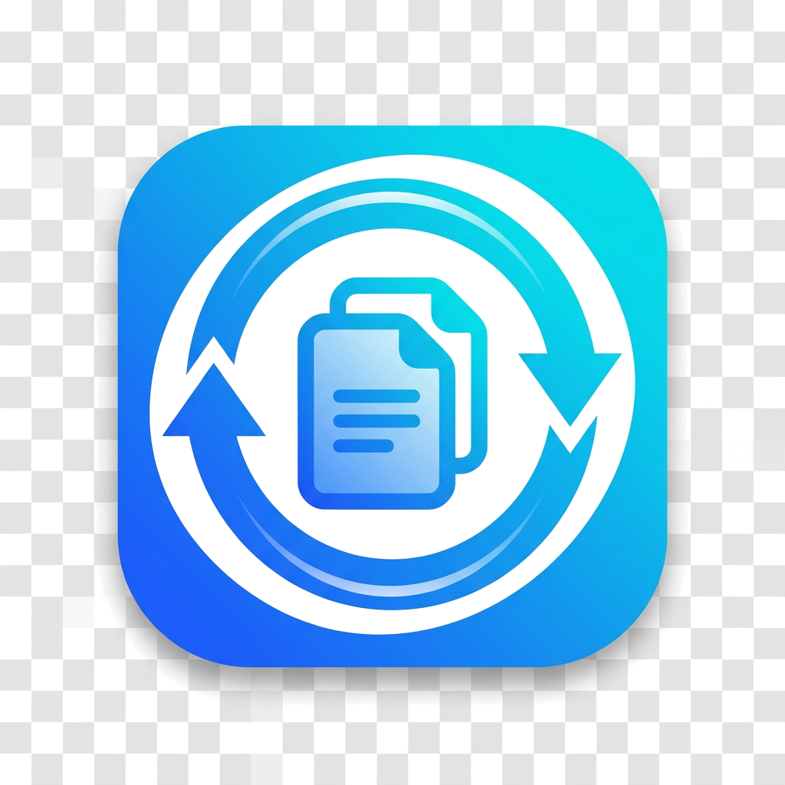

<div align="center">

<picture>
  <source media="(prefers-color-scheme: dark)" srcset="assets/logo.png">
  
</picture>

# UniConvert

**The universal file converter for Windows, macOS & Linux**

Drag files in · pick a format · click Convert. **300+ format pairs** — audio, video, images, documents, e‑books, archives, spreadsheets, and code — all in a single, clean, offline desktop app.

[](LICENSE)
[](#install)
[](https://python.org)
[](https://github.com/Comet-Suite/UniConvert/releases/latest)
[](https://github.com/Comet-Suite/UniConvert/actions/workflows/test.yml)
[](https://github.com/Comet-Suite/UniConvert/releases)

[⬇ Download latest release](https://github.com/Comet-Suite/UniConvert/releases/latest) ·
[📦 Install](#install) ·
[🚀 Quick start](#quick-start) ·
[🧰 Build from source](#build-from-source) ·
[🧪 CLI](#command-line-interface) ·
[🤝 Contribute](#contributing)

</div>

---

## ✨ What it does

UniConvert is a **drag‑and‑drop batch file converter** that lives in your menubar / system tray. Pick files, pick a target format, click **Convert** — UniConvert dispatches each job to the fastest available backend and shows live progress. Right‑click any file in Explorer, Finder, or Nautilus and choose **Convert with UniConvert…** for one‑click conversion.

### 🎯 Supported categories

| Category | In → Out (examples) | Backend |
|---|---|---|
| 🔊 **Audio** | MP3 ↔ WAV ↔ FLAC ↔ AAC ↔ OGG ↔ M4A ↔ WMA ↔ Opus ↔ AIFF ↔ AC3 ↔ DTS ↔ AMR … | [FFmpeg](https://ffmpeg.org) |
| 🎬 **Video** | MP4 ↔ MKV ↔ MOV ↔ AVI ↔ WebM ↔ WMV ↔ FLV ↔ 3GP ↔ GIF; video → audio extraction | [FFmpeg](https://ffmpeg.org) |
| 🖼️ **Images** | JPG ↔ PNG ↔ WebP ↔ BMP ↔ TIFF ↔ GIF ↔ HEIC ↔ AVIF ↔ SVG ↔ PDF; RAW camera formats | [Pillow](https://python-pillow.org) + FFmpeg |
| 📄 **Documents** | PDF ↔ DOCX ↔ ODT ↔ RTF ↔ TXT ↔ HTML ↔ Markdown; XLSX/PPTX → PDF; EPUB/MOBI/AZW3 e‑books | [Pandoc](https://pandoc.org) |
| 📦 **Archives** | ZIP ↔ 7z ↔ TAR ↔ GZ ↔ BZ2 ↔ RAR (with unrar) | Python stdlib + 7‑Zip / unrar |
| 📊 **Data** | CSV ↔ JSON ↔ YAML ↔ XML ↔ XLSX ↔ XLS ↔ ODS ↔ HTML | [pandas](https://pandas.pydata.org) + openpyxl |
| 💻 **Code / text** | Syntax‑highlighted HTML; Python ↔ JS ↔ Java ↔ C++ ↔ Go ↔ Rust ↔ … (lossy, with disclaimer header) | stdlib |

> **Tip:** Install `ffmpeg` (required for audio/video/GIF) and `pandoc` (recommended for DOCX/EPUB/PDF-rich docs) to unlock the full matrix.

### 🧩 Features

- 🖱️ **Drag‑and‑drop batch UI** with per‑file status and live progress
- ❌ **Cancel in progress** at any time
- 🧊 **System tray** — minimize to tray, close‑to‑tray, show/hide from tray menu
- 🔁 **Cross‑platform "Start at login"** toggle (Windows Registry / Linux `.desktop` autostart / macOS LaunchAgent)
- 📂 **Right‑click shell integration** — Windows Explorer, GNOME Nautilus (and Finder via macOS Services if you wire it up)
- 🧑‍💻 **Headless CLI** for scripting and CI: `uniconvert *.mp3 --to wav -o ./out/`
- 🎨 **Clean Qt interface** with dark/light native theme, transparent app icon
- 🔌 **Sensible defaults** — MP3 uses LAME V2, MP4 uses H.264/AAC, images use quality‑preserving settings
- 🛡️ **Offline, no telemetry, no cloud calls**, MIT licensed

---

## 📥 Install

Download the right build for your platform from the [latest release](https://github.com/Comet-Suite/UniConvert/releases/latest).

### Windows (10 / 11, x64)

**Installer (recommended):**
1. Download **`UniConvert-0.1.0-Setup.exe`**
2. Run the installer — no admin needed; installs to `%LOCALAPPDATA%\Programs\UniConvert`
3. Launch **UniConvert** from the Start Menu, or right‑click any file → **Convert with UniConvert…**

**Portable:**
1. Download **`UniConvert-0.1.0-portable-windows.zip`** and unzip anywhere
2. Double‑click **`setup.bat`** once to unpack the bundled Python runtime and dependencies (no system install needed)
3. Run **`UniConvert.exe`**

> For audio/video you'll also want [FFmpeg](https://www.gyan.dev/ffmpeg/builds/) on your `PATH` (drop `ffmpeg.exe` next to `UniConvert.exe` for portable installs).

### Linux (Debian / Ubuntu / Pop!_OS / Mint / …)

```bash
# 1. Required runtime dependency for audio/video conversions
sudo apt update && sudo apt install -y ffmpeg

# 2. Recommended for rich document / e-book conversions
sudo apt install -y pandoc

# 3. Install UniConvert
sudo dpkg -i uniconvert_0.1.0_amd64.deb
```

- The `.deb` drops `uniconvert` into `/usr/bin`, installs the app icon, a `.desktop` launcher, and a **Nautilus (GNOME Files) right‑click extension** (restart Nautilus with `nautilus -q` to enable).
- For non‑Debian distros, use the **portable tarball**: extract and run `./uniconvert_linux` (requires `ffmpeg`; `pandoc` optional).

### macOS (10.15 Catalina or later)

1. Download **`UniConvert-0.1.0-macOS.zip`** and unzip
2. Drag **UniConvert.app** into `/Applications`
3. **First launch:** right‑click the app → **Open** (bypasses Gatekeeper for an unsigned app)
4. Optional: `brew install ffmpeg pandoc` for full format coverage

> The macOS bundle bootstraps its own Python dependencies (`PyQt6`, `Pillow`, `pandas`, …) into `~/Library` on first launch. For a fully native `.dmg` with pre‑bundled deps, build on macOS with `bash installers/macos/build_dmg.sh` or use the GitHub Actions release workflow.

---

## 🚀 Quick start

1. **Launch UniConvert** from the Start Menu / Applications menu / terminal (`uniconvert`).
2. **Drag files** onto the window (or click **Add files…**).
3. Pick a **category** (Audio / Video / Image / Document / …) and a **target format** from the dropdown.
4. *(Optional)* Click **Choose folder…** to pick an output directory (defaults to same‑folder‑as‑source).
5. Click **Convert**. Watch per‑file progress, cancel any time.
6. Files that don't support the selected format are skipped automatically.


---

## 🧑‍💻 Command‑line interface

UniConvert ships with a full CLI for batch jobs, scripts, and servers:

```bash
# Convert every MP3 in a folder to WAV
uniconvert *.mp3 --to wav -o ./wav_output/

# Convert a CSV to JSON and a DOCX to PDF
uniconvert data.csv report.docx --to pdf

# List every supported (From, To) pair
uniconvert --list-formats | head -20

# Overwrite existing outputs and run non-interactively
uniconvert -f input.mp4 --to gif
```

Exit code is `0` on full success, `1` if any file failed — safe for CI pipelines.

---

## 🧰 Build from source

```bash
git clone https://github.com/Comet-Suite/UniConvert.git
cd UniConvert

# Recommended: virtual environment
python3 -m venv .venv && source .venv/bin/activate   # Windows: .venv\Scripts\activate

# Install with optional "full" extras (pandas / openpyxl / PyYAML / pypdf)
pip install -e ".[full]"

# Run
python -m uniconvert            # GUI
uniconvert --help               # CLI
```

**System dependencies** (for full format coverage):
- **ffmpeg** — audio, video, GIF, HEIC/AVIF, RAW
- **pandoc** — DOCX/ODT/RTF/EPUB/MOBI/PPTX conversions
- **7z / unrar** *(optional)* — 7‑Zip and RAR archive support

### 🏗️ Build installers yourself

```bash
make test                   # run the test suite
make build-linux            # PyInstaller one-folder bundle (dist/uniconvert_linux)
make deb                    # build the .deb (Linux)
make build-windows          # build Windows .exe installer (requires NSIS)
make build-macos            # build macOS .app / .dmg (run on macOS)
```

See `installers/<platform>/` for per-platform build scripts (`build_deb.sh`, `build_exe.ps1`, `build_dmg.sh`).

---

## 📁 Project layout

```
UniConvert/
├── uniconvert/
│   ├── __init__.py        # version / metadata
│   ├── __main__.py        # python -m uniconvert
│   ├── formats.py         # CSV-backed format registry + categories
│   ├── converter.py       # dispatcher & backends (ffmpeg / Pillow / pandas / archives …)
│   ├── gui.py             # PyQt6 main window, drag & drop, tray, progress, shell
│   └── cli.py             # argparse-based headless CLI
├── assets/
│   ├── formats.csv        # the canonical 300+ (From, To) pairs
│   ├── logo.png / .ico    # your transparent branding
├── installers/
│   ├── windows/           # NSIS script, native C launcher, .reg context menu, PowerShell builder
│   ├── linux/             # .deb builder, .desktop, AppStream metadata, Nautilus extension
│   └── macos/             # .app/.dmg builder, iconset
├── tests/                 # pytest suite (13 cases, covering registry / converter / CLI)
├── .github/workflows/     # CI tests + multi-platform release pipeline
├── main.py                # PyInstaller entry point
├── setup.py · Makefile · MANIFEST.in · LICENSE · README.md
```

---

## ✅ Running tests

```bash
pip install pytest Pillow pandas openpyxl PyYAML PyQt6
sudo apt install -y ffmpeg     # for the audio roundtrip test
pytest -q                      # run all tests
```

CI runs the suite on every push on Ubuntu (Linux), Windows, and macOS.

---

## 🛣️ Roadmap

- [ ] Drag‑and‑drop folders (recursive batch conversion)
- [ ] Per‑file format overrides in the batch list
- [ ] Preset quality profiles (low / medium / high / lossless)
- [ ] Parallel conversion pool (configurable worker count)
- [ ] Full macOS Finder Sync extension and signed/notarized `.dmg`
- [ ] Windows 11 IExplorerCommand shell extension (modern right‑click menu)
- [ ] Optional AI‑assisted code‑to‑code translation backend
- [ ] Dark/light theme toggle and custom accent colors

---

## 🤝 Contributing

1. Fork the repo and create a feature branch (`git checkout -b feat/my-thing`)
2. Install dev dependencies: `pip install -e ".[full]" pytest`
3. Make changes, add tests under `tests/`, make sure `pytest` passes
4. Commit in clear, logical chunks (see existing commit history)
5. Open a pull request against `master`

Issues and feature requests welcome — please open one [here](https://github.com/Comet-Suite/UniConvert/issues).

---

## 📜 License

Released under the **MIT License**. See [`LICENSE`](LICENSE) for details.

FFmpeg, Pillow, pandas, PyQt6, and other bundled/linked libraries are under their own respective licenses; see each project's website for details.

---

<div align="center">

<sub>Made with ❤️ · Built offline · No telemetry · Powered by FFmpeg, Pillow, pandas & Qt.</sub>

[⭐ Star the project](https://github.com/Comet-Suite/UniConvert) · [🐛 Report a bug](https://github.com/Comet-Suite/UniConvert/issues) · [💡 Request a feature](https://github.com/Comet-Suite/UniConvert/issues)

</div>
